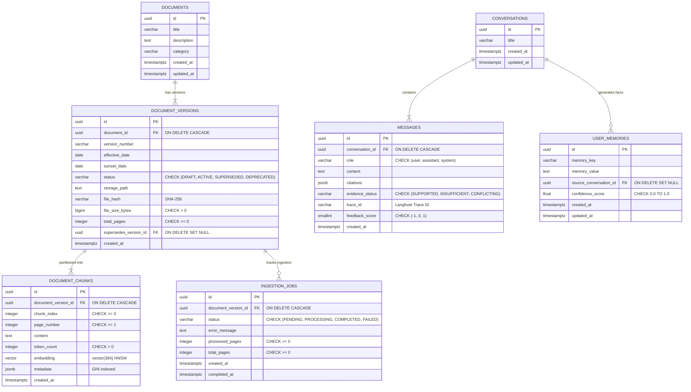

# KnowBridge AI — Database Design & Schema Specification

**Document Version:** 1.1.0  
**Status:** Implemented (Task 02A Baseline)  
**Author:** Senior PostgreSQL Database Engineer  
**Target Systems:** Enterprise Knowledge Intelligence Platform  

---

## 1. Database Architecture & Technology Stack

KnowBridge AI utilizes **Supabase PostgreSQL** as its single, unified operational and vector datastore:
- **Relational Storage:** PostgreSQL 15+ managing documents, versions, chunks, conversations, messages, user memory, and ingestion state.
- **Vector Search Engine:** `pgvector` extension supporting high-dimensional embedding storage and approximate nearest neighbor (ANN) indexing via **HNSW (Hierarchical Navigable Small World)**.
- **Embedding Alignment:** Standardized on `vector(384)` matching the in-process `sentence-transformers/all-MiniLM-L6-v2` model (cosine similarity distance).
- **Primary Key Standard:** Universal UUID v4 identifiers (`gen_random_uuid()`) across all tables to avoid sequential ID enumeration and ensure distributed scalability.
- **Scope Restriction Enforcement:** Supabase Row Level Security (RLS) is disabled for the MVP, and authentication/authorization is out of scope. The database operates in a single-workspace development configuration. Original PDF documents are saved directly to Supabase Storage (bucket: `knowbridge-documents`), with paths tracked in `document_versions.storage_path`.

---

## 2. Entity-Relationship (ER) Diagram (7 MVP Tables)



---

## 3. Comprehensive Data Dictionary (MVP Entities)

---

### Table 1: `documents`
Represents the top-level identity of an organizational policy or manual.

| Column Name | Data Type | PK | FK | Nullable | Default | Constraints / Description |
|---|---|---|---|---|---|---|
| `id` | `UUID` | Yes | No | No | `gen_random_uuid()` | Unique document entity identifier. |
| `title` | `VARCHAR(255)` | No | No | No | None | Human-readable document title (e.g., "Global Travel Policy"). |
| `description` | `TEXT` | No | No | Yes | NULL | Optional high-level summary of the document. |
| `category` | `VARCHAR(100)` | No | No | No | `'general'` | Departmental taxonomy (e.g., HR, Finance, Engineering, Legal). |
| `created_at` | `TIMESTAMPTZ` | No | No | No | `NOW()` | Timestamp when document record was created. |
| `updated_at` | `TIMESTAMPTZ` | No | No | No | `NOW()` | Timestamp when document metadata was last modified (auto-updated via trigger). |

---

### Table 2: `document_versions`
Tracks revisions, publication lifecycle, temporal validity (effective/sunset dates), and file metadata.

| Column Name | Data Type | PK | FK | Nullable | Default | Constraints / Description |
|---|---|---|---|---|---|---|
| `id` | `UUID` | Yes | No | No | `gen_random_uuid()` | Unique document version identifier. |
| `document_id` | `UUID` | No | Yes $\to$ `documents(id)` | No | None | Parent document (`ON DELETE CASCADE`). |
| `version_number` | `VARCHAR(50)` | No | No | No | None | Semantic version string (e.g., `'v1.0'`, `'v3.2'`). |
| `effective_date` | `DATE` | No | No | No | None | Date the policy becomes legally operational. |
| `sunset_date` | `DATE` | No | No | Yes | NULL | Date the policy expires or is superseded (`sunset_date >= effective_date`). |
| `status` | `VARCHAR(50)` | No | No | No | `'ACTIVE'` | `CHECK (status IN ('DRAFT', 'ACTIVE', 'SUPERSEDED', 'DEPRECATED'))`. |
| `storage_path` | `TEXT` | No | No | No | None | Key path of binary PDF in Supabase Storage (`knowbridge-documents`). |
| `file_hash` | `VARCHAR(64)` | No | No | No | None | SHA-256 hexadecimal hash for file deduplication. |
| `file_size_bytes` | `BIGINT` | No | No | No | None | `CHECK (file_size_bytes > 0)`: Binary file size in bytes. |
| `total_pages` | `INTEGER` | No | No | No | `0` | `CHECK (total_pages >= 0)`: Total physical pages in PDF. |
| `supersedes_version_id` | `UUID` | No | Yes $\to$ `document_versions(id)` | Yes | NULL | Version superseded by this revision (`ON DELETE SET NULL`). |
| `created_at` | `TIMESTAMPTZ` | No | No | No | `NOW()` | Version creation timestamp. |

---

### Table 3: `document_chunks`
Stores text segments, physical page provenance, token counts, and dense vector embeddings.

| Column Name | Data Type | PK | FK | Nullable | Default | Constraints / Description |
|---|---|---|---|---|---|---|
| `id` | `UUID` | Yes | No | No | `gen_random_uuid()` | Unique chunk identifier. |
| `document_version_id` | `UUID` | No | Yes $\to$ `document_versions(id)` | No | None | Source version (`ON DELETE CASCADE`). |
| `chunk_index` | `INTEGER` | No | No | No | None | `CHECK (chunk_index >= 0)`: Zero-based sequential chunk index. |
| `page_number` | `INTEGER` | No | No | No | None | `CHECK (page_number >= 1)`: Physical page number in source PDF. |
| `content` | `TEXT` | No | No | No | None | Chunk text extracted and cleaned by PyMuPDF. |
| `token_count` | `INTEGER` | No | No | No | None | `CHECK (token_count > 0)`: Approximate token count of chunk. |
| `embedding` | `VECTOR(384)` | No | No | No | None | 384-dimensional dense vector (`all-MiniLM-L6-v2`). |
| `metadata` | `JSONB` | No | No | No | `'{}'::jsonb` | Additional metadata (headings, table flags, document title). |
| `created_at` | `TIMESTAMPTZ` | No | No | No | `NOW()` | Timestamp when chunk was indexed. |

---

### Table 4: `conversations`
Tracks conversational sessions and chat threads.

| Column Name | Data Type | PK | FK | Nullable | Default | Constraints / Description |
|---|---|---|---|---|---|---|
| `id` | `UUID` | Yes | No | No | `gen_random_uuid()` | Unique conversation thread identifier (`thread_id` in LangGraph). |
| `title` | `VARCHAR(255)` | No | No | No | `'New Conversation'` | Human-readable title summarized from conversation turns. |
| `created_at` | `TIMESTAMPTZ` | No | No | No | `NOW()` | Timestamp when thread was initiated. |
| `updated_at` | `TIMESTAMPTZ` | No | No | No | `NOW()` | Timestamp of last message in this thread (auto-updated via trigger). |

---

### Table 5: `messages`
Stores individual conversation turns, evidence status, citations, and user feedback.

| Column Name | Data Type | PK | FK | Nullable | Default | Constraints / Description |
|---|---|---|---|---|---|---|
| `id` | `UUID` | Yes | No | No | `gen_random_uuid()` | Unique message identifier. |
| `conversation_id` | `UUID` | No | Yes $\to$ `conversations(id)` | No | None | Parent conversation thread (`ON DELETE CASCADE`). |
| `role` | `VARCHAR(20)` | No | No | No | None | `CHECK (role IN ('user', 'assistant', 'system'))`. |
| `content` | `TEXT` | No | No | No | None | Text content of the prompt or generated answer. |
| `citations` | `JSONB` | No | No | Yes | `'[]'::jsonb` | JSON array of citation objects: `[{doc_title, page, snippet}]`. |
| `evidence_status` | `VARCHAR(50)` | No | No | Yes | NULL | `CHECK (evidence_status IN ('SUPPORTED', 'INSUFFICIENT', 'CONFLICTING', NULL))`. |
| `trace_id` | `VARCHAR(100)` | No | No | Yes | NULL | Correlated Langfuse trace ID for observability. |
| `feedback_score` | `SMALLINT` | No | No | Yes | NULL | `CHECK (feedback_score IN (-1, 0, 1, NULL))`: User feedback score. |
| `created_at` | `TIMESTAMPTZ` | No | No | No | `NOW()` | Timestamp when message was created. |

---

### Table 6: `user_memories`
Stores persistent factual context extracted across conversation sessions.

| Column Name | Data Type | PK | FK | Nullable | Default | Constraints / Description |
|---|---|---|---|---|---|---|
| `id` | `UUID` | Yes | No | No | `gen_random_uuid()` | Unique memory identifier. |
| `memory_key` | `VARCHAR(100)` | No | No | No | None | Extracted memory key (e.g., `'department'`, `'work_location'`). |
| `memory_value` | `TEXT` | No | No | No | None | Value of the fact (e.g., `'Engineering'`, `'London'`). |
| `source_conversation_id` | `UUID` | No | Yes $\to$ `conversations(id)` | Yes | NULL | Originating conversation (`ON DELETE SET NULL`). |
| `confidence_score` | `FLOAT` | No | No | No | `1.0` | `CHECK (confidence_score >= 0.0 AND confidence_score <= 1.0)`. |
| `created_at` | `TIMESTAMPTZ` | No | No | No | `NOW()` | Timestamp when fact was created. |
| `updated_at` | `TIMESTAMPTZ` | No | No | No | `NOW()` | Timestamp when fact was modified (auto-updated via trigger). |

---

### Table 7: `ingestion_jobs`
Tracks asynchronous document parsing, chunking, and embedding progress.

| Column Name | Data Type | PK | FK | Nullable | Default | Constraints / Description |
|---|---|---|---|---|---|---|
| `id` | `UUID` | Yes | No | No | `gen_random_uuid()` | Unique ingestion job identifier. |
| `document_version_id` | `UUID` | No | Yes $\to$ `document_versions(id)` | No | None | Target version being processed (`ON DELETE CASCADE`). |
| `status` | `VARCHAR(50)` | No | No | No | `'PENDING'` | `CHECK (status IN ('PENDING', 'PROCESSING', 'COMPLETED', 'FAILED'))`. |
| `error_message` | `TEXT` | No | No | Yes | NULL | Error description if ingestion failed. |
| `processed_pages` | `INTEGER` | No | No | No | `0` | `CHECK (processed_pages >= 0)`: Processed page count. |
| `total_pages` | `INTEGER` | No | No | No | `0` | `CHECK (total_pages >= 0)`: Total page count. |
| `created_at` | `TIMESTAMPTZ` | No | No | No | `NOW()` | Job registration timestamp. |
| `completed_at` | `TIMESTAMPTZ` | No | No | Yes | NULL | Job completion or failure timestamp. |

---

## 4. Comprehensive Index & Constraint Documentation

### 4.1 Index Matrix
The table below documents every index created, its storage engine, indexing algorithm, and the specific query workload it optimizes:

| Index Name | Table | Columns | Type / Algorithm | Optimization Purpose |
|---|---|---|---|---|
| `idx_chunks_embedding_hnsw` | `document_chunks` | `embedding` | **HNSW (`vector_cosine_ops`)** | Approximate Nearest Neighbor (ANN) vector similarity search (`<=>` cosine operator). Parameters: `m = 16`, `ef_construction = 64`. |
| `idx_documents_category` | `documents` | `category` | B-Tree | Accelerates departmental document filtering (e.g., `WHERE category = 'HR'`). |
| `idx_doc_versions_doc_status` | `document_versions` | `(document_id, status)` | Composite B-Tree | Fast lookup of active versions for a given document. |
| `idx_doc_versions_temporal` | `document_versions` | `(effective_date, sunset_date)` | Composite B-Tree | Temporal range filtering (`effective_date <= target_date AND (sunset_date IS NULL OR sunset_date >= target_date)`). |
| `idx_doc_versions_hash` | `document_versions` | `file_hash` | B-Tree | Fast deduplication check during PDF upload. |
| `idx_doc_versions_supersedes` | `document_versions` | `supersedes_version_id` | B-Tree | Foreign key traversal for version revision history. |
| `idx_chunks_version_page` | `document_chunks` | `(document_version_id, page_number)` | Composite B-Tree | Rapid citation resolution (retrieving all chunks on a specific page of a document version). |
| `idx_chunks_metadata_gin` | `document_chunks` | `metadata` | **GIN (`jsonb_ops`)** | Fast JSONB containment and key queries (`metadata @> '{"heading": "Section 4"}'`). |
| `idx_conversations_updated` | `conversations` | `updated_at DESC` | B-Tree | Chronological conversation thread listing in chat sidebar. |
| `idx_messages_conversation_created` | `messages` | `(conversation_id, created_at ASC)` | Composite B-Tree | Sequential message retrieval for LangGraph conversation context reconstruction. |
| `idx_messages_trace_id` | `messages` | `trace_id` | B-Tree | Linking user feedback to Langfuse observability traces. |
| `idx_user_memories_key` | `user_memories` | `memory_key` | B-Tree | Fast lookup of persistent facts during query rewriting. |
| `idx_user_memories_conversation` | `user_memories` | `source_conversation_id` | B-Tree | Foreign key lookup for memories originating from a conversation. |
| `idx_ingestion_jobs_version` | `ingestion_jobs` | `document_version_id` | B-Tree | Tracking and polling background ingestion jobs. |
| `idx_ingestion_jobs_status` | `ingestion_jobs` | `status` | B-Tree | Filtering active, pending, or failed ingestion jobs. |

### 4.2 Foreign Key Cascading Strategy
- **`ON DELETE CASCADE`:** Applied to dependent child tables (`documents` $\to$ `document_versions` $\to$ `document_chunks`, `document_versions` $\to$ `ingestion_jobs`, `conversations` $\to$ `messages`). Deleting a parent document cleanly removes all its versions, chunks, and ingestion logs without orphaned data.
- **`ON DELETE SET NULL`:** Applied to informational cross-references (`document_versions.supersedes_version_id` and `user_memories.source_conversation_id`). Deleting an older version or conversation preserves the dependent version and extracted memory facts.

---

## 5. Policy-Aware Vector Search Function (`match_policy_chunks`)

The core retrieval procedure combines dense vector search with temporal and lifecycle metadata filtering:

```sql
CREATE OR REPLACE FUNCTION match_policy_chunks(
    query_embedding VECTOR(384),
    target_date DATE DEFAULT CURRENT_DATE,
    match_threshold FLOAT DEFAULT 0.65,
    match_count INTEGER DEFAULT 5
)
RETURNS TABLE (
    chunk_id UUID,
    document_id UUID,
    document_title VARCHAR(255),
    version_id UUID,
    version_number VARCHAR(50),
    effective_date DATE,
    sunset_date DATE,
    page_number INTEGER,
    content TEXT,
    similarity FLOAT,
    chunk_metadata JSONB
)
LANGUAGE plpgsql
AS $$
BEGIN
    RETURN QUERY
    SELECT
        c.id AS chunk_id,
        d.id AS document_id,
        d.title AS document_title,
        v.id AS version_id,
        v.version_number,
        v.effective_date,
        v.sunset_date,
        c.page_number,
        c.content,
        (1 - (c.embedding <=> query_embedding))::FLOAT AS similarity,
        c.metadata AS chunk_metadata
    FROM document_chunks c
    JOIN document_versions v ON c.document_version_id = v.id
    JOIN documents d ON v.document_id = d.id
    WHERE v.status = 'ACTIVE'
      AND v.effective_date <= target_date
      AND (v.sunset_date IS NULL OR v.sunset_date >= target_date)
      AND (1 - (c.embedding <=> query_embedding)) >= match_threshold
    ORDER BY c.embedding <=> query_embedding ASC
    LIMIT match_count;
END;
$$;
```

---

## 6. Step-by-Step Database Setup Instructions

Follow these instructions to initialize the KnowBridge AI database in your Supabase project:

### Step 1: Create a Supabase Project
1. Log in to [Supabase Console](https://supabase.com/dashboard).
2. Create a new project named `knowbridge-ai`.
3. Note your **Database Connection String** (`postgresql://postgres:[PASSWORD]@[HOST]:5432/postgres`) and **Project URL / API Keys**.

### Step 2: Create Storage Bucket for Original Documents
1. Navigate to **Storage** in the Supabase Dashboard.
2. Click **New Bucket**.
3. Name the bucket: `knowbridge-documents`.
4. Leave **Public Bucket** unchecked (private storage; the backend accesses it using the Supabase Service Role Key).
5. Click **Save**.

### Step 3: Run Database Migrations
You can apply the migrations using either the Supabase Dashboard SQL Editor or the psql CLI:

**Option A: Supabase SQL Editor (Fastest)**
1. In the Supabase Dashboard, go to **SQL Editor**.
2. Open [`backend/migrations/000_full_migration.sql`](file:///c:/Users/hansi/OneDrive/Desktop/KnowBridge%20AI/backend/migrations/000_full_migration.sql).
3. Paste the contents into the editor and click **Run**.
4. The console will display `Success. No rows returned`, confirming extensions, tables, indexes, and procedures are created.

**Option B: Command Line via `psql`**
```bash
psql "postgresql://postgres:[PASSWORD]@[HOST]:5432/postgres" -f backend/migrations/001_initial_schema.sql
psql "postgresql://postgres:[PASSWORD]@[HOST]:5432/postgres" -f backend/migrations/002_indexes_and_functions.sql
```

### Step 4: Execute Schema Validation Script
1. In the Supabase SQL Editor, open [`backend/migrations/validate_schema.sql`](file:///c:/Users/hansi/OneDrive/Desktop/KnowBridge%20AI/backend/migrations/validate_schema.sql).
2. Paste and click **Run**.
3. Inspect the execution output. You should observe:
   ```
   NOTICE: Extensions "vector" and "uuid-ossp" are installed and active.
   NOTICE: All 7 MVP tables exist in public schema.
   NOTICE: document_chunks.embedding is confirmed as vector(384).
   NOTICE: HNSW index idx_chunks_embedding_hnsw is present.
   NOTICE: Stored function match_policy_chunks is registered.
   NOTICE: match_policy_chunks executed successfully with vector similarity.
   NOTICE: ON DELETE CASCADE correctly purged versions, chunks, and ingestion jobs.
   NOTICE: ON DELETE SET NULL and cleanup confirmed for conversations & memories.
   NOTICE: KNOWBRIDGE AI DATABASE VALIDATION: ALL CHECKS PASSED!
   NOTICE: Zero test rows remain in the database.
   ```

### Step 5: Configure Backend Environment Variables
Create `backend/.env` with the following keys:
```env
SUPABASE_URL=https://[YOUR_PROJECT_REF].supabase.co
SUPABASE_SERVICE_ROLE_KEY=[YOUR_SUPABASE_SERVICE_ROLE_KEY]
DATABASE_URL=postgresql://postgres:[PASSWORD]@[HOST]:5432/postgres
STORAGE_BUCKET_NAME=knowbridge-documents
EMBEDDING_MODEL_NAME=sentence-transformers/all-MiniLM-L6-v2
EMBEDDING_DIMENSION=384
```
