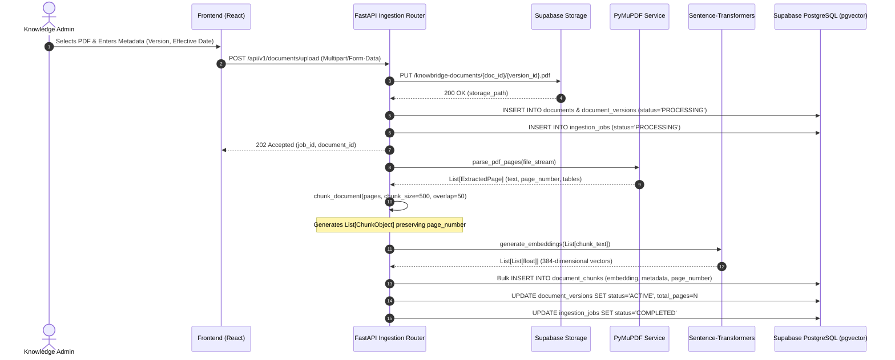
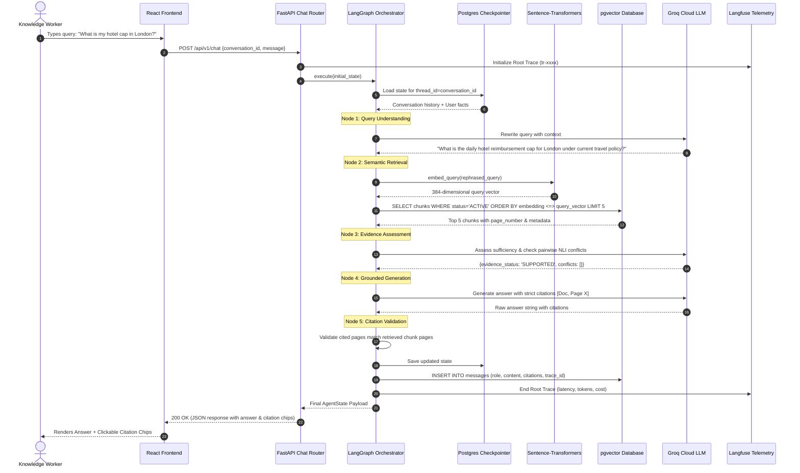
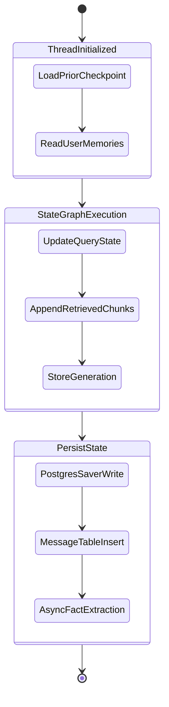
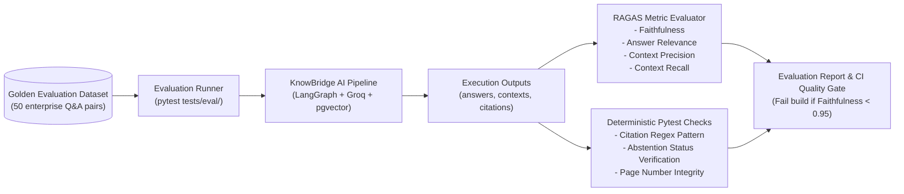

# KnowBridge AI — Data Flow Specifications

**Document Version:** 1.0.0  
**Status:** Under Review (Task 02 Specification)  
**Author:** Senior Software Architect & AI Engineer  
**Target Systems:** Enterprise Knowledge Intelligence Platform  

---

## 1. End-to-End Data Flow Overview

This document specifies the data transformations, payload schemas, and serialization formats across every subsystem in KnowBridge AI:
1. **Document Ingestion & Indexing Pipeline**
2. **Conversational Query Execution Pipeline**
3. **State Checkpointing & Persistent Memory Lifecycle**
4. **Observability & Telemetry Data Flow (Langfuse)**
5. **Quality Evaluation Data Flow (RAGAS & Pytest)**

---

## 2. Ingestion & Indexing Data Flow



### 2.1 Ingestion Payload Transformation Schemas

#### Step 1: Client Upload Request (`multipart/form-data`)
```http
POST /api/v1/documents/upload HTTP/1.1
Content-Type: multipart/form-data; boundary=----WebKitFormBoundary

------WebKitFormBoundary
Content-Disposition: form-data; name="title"

Global Travel & Expense Policy 2024
------WebKitFormBoundary
Content-Disposition: form-data; name="version_number"

v3.2
------WebKitFormBoundary
Content-Disposition: form-data; name="effective_date"

2024-01-01
------WebKitFormBoundary
Content-Disposition: form-data; name="category"

Finance
------WebKitFormBoundary
Content-Disposition: form-data; name="file"; filename="Travel_Policy_2024.pdf"
Content-Type: application/pdf

[RAW BINARY DATA]
------WebKitFormBoundary--
```

#### Step 2: PyMuPDF Extracted Page Object (In-Memory)
```json
{
  "page_number": 14,
  "raw_text": "Section 4.2 International Travel Caps\nTier 1 Cities (London, Tokyo): Hotel cap is £250/night. Meals cap is £80/day.",
  "tables": [
    {
      "headers": ["City Tier", "Hotel Cap", "Daily Meals Cap"],
      "rows": [
        ["Tier 1 (London, Tokyo)", "£250 GBP", "£80 GBP"],
        ["Tier 2 (Regional)", "£180 GBP", "£60 GBP"]
      ]
    }
  ],
  "char_count": 348
}
```

#### Step 3: Chunked Data Object Before Embedding
```json
{
  "document_version_id": "9e8d7c6b-4f1b-489e-9d22-b52b2f0a1234",
  "chunk_index": 28,
  "page_number": 14,
  "token_count": 182,
  "content": "Section 4.2 International Travel Caps\nTier 1 Cities (London, Tokyo):\n| City Tier | Hotel Cap | Daily Meals Cap |\n| Tier 1 (London, Tokyo) | £250 GBP | £80 GBP |\n| Tier 2 (Regional) | £180 GBP | £60 GBP |",
  "metadata": {
    "document_title": "Global Travel & Expense Policy 2024",
    "version": "v3.2",
    "effective_date": "2024-01-01",
    "category": "Finance",
    "page_number": 14
  }
}
```

#### Step 4: Database Storage Schema in `document_chunks`
```sql
INSERT INTO document_chunks (
    id,
    document_version_id,
    chunk_index,
    page_number,
    content,
    token_count,
    embedding,
    metadata,
    created_at
) VALUES (
    gen_random_uuid(),
    '9e8d7c6b-4f1b-489e-9d22-b52b2f0a1234',
    28,
    14,
    'Section 4.2 International Travel Caps...',
    182,
    '[-0.0412, 0.0891, ..., 0.0124]'::vector,
    '{"document_title": "Global Travel & Expense Policy 2024", "version": "v3.2", "page_number": 14}'::jsonb,
    NOW()
);
```

---

## 3. Conversational Query Execution Data Flow



### 3.1 Query Payload Transformation Schemas

#### Step 1: User Request Payload (`POST /api/v1/chat`)
```json
{
  "conversation_id": "4caf45f1-a470-4620-ae65-f702493f2133",
  "message": "What is my daily hotel reimbursement cap for London?",
  "temporal_target_date": "2024-11-21"
}
```

#### Step 2: pgvector Similarity Search Query
```sql
SELECT 
    c.id AS chunk_id,
    c.page_number,
    c.content,
    c.token_count,
    v.version_number,
    d.title AS document_title,
    1 - (c.embedding <=> :query_vector) AS cosine_similarity
FROM document_chunks c
JOIN document_versions v ON c.document_version_id = v.id
JOIN documents d ON v.document_id = d.id
WHERE v.status = 'ACTIVE'
  AND v.effective_date <= :target_date
  AND (v.sunset_date IS NULL OR v.sunset_date >= :target_date)
ORDER BY c.embedding <=> :query_vector
LIMIT 5;
```

#### Step 3: Evidence Assessment Output (In-Memory State)
```json
{
  "evidence_status": "SUPPORTED",
  "max_similarity_score": 0.892,
  "conflict_detected": false,
  "conflicts": [],
  "selected_chunk_ids": [
    "chunk_uuid_28",
    "chunk_uuid_29"
  ]
}
```

#### Step 4: Final JSON Response Payload to Frontend
```json
{
  "conversation_id": "4caf45f1-a470-4620-ae65-f702493f2133",
  "message_id": "msg_88192a_uuid",
  "answer": "Under the 2024 Global Travel Policy, the hotel lodging reimbursement for London (classified as a Tier 1 City) is capped at **£250 GBP per night** excluding taxes [Global Travel & Expense Policy 2024, Page 14].",
  "evidence_status": "SUPPORTED",
  "citations": [
    {
      "citation_id": 1,
      "document_title": "Global Travel & Expense Policy 2024",
      "version": "v3.2",
      "page_number": 14,
      "snippet": "Tier 1 Cities (London, Tokyo): Hotel cap is £250/night."
    }
  ],
  "conflicts": [],
  "trace_id": "tr-langfuse-89124-prod"
}
```

---

## 4. State Checkpointing & Memory Lifecycle



1. **State Keying:** State is strictly keyed by `thread_id` equal to `conversation_id`.
2. **Postgres Checkpointer:** At each node completion, LangGraph serializes the `AgentState` dictionary into PostgreSQL binary state (`checkpoints` and `checkpoint_blobs` tables managed by `langgraph.checkpoint.postgres`).
3. **Background Memory Extraction:** When the conversation completes, a background task analyzes the user message for explicit operational facts (e.g., *"I work in the UK department"*). Extracted key-values are written to `user_memories`.

---

## 5. Observability & Telemetry Data Flow (Langfuse)

```
  [User Request] ───> [FastAPI Chat Router]
                             │
                             ▼
                    ┌─────────────────────────┐
                    │ Langfuse Client         │
                    │ Trace: "chat_query"     │
                    └────────────┬────────────┘
                                 │
     ┌───────────────────────────┼───────────────────────────┐
     ▼                           ▼                           ▼
[Span 1: QueryRewrite]  [Span 2: pgvectorSearch]    [Generation: Groq Synthesis]
- Latency: 180ms        - Latency: 42ms             - Latency: 720ms
- Tokens: 45 in / 28 out- Rows Returned: 5          - Tokens: 512 in / 112 out
- Model: llama-3.1-8b   - Top Score: 0.892          - Model: llama-3.3-70b
                                                    - Cost: $0.00042 USD
                                 │
                                 ▼
                     ┌────────────────────────┐
                     │ End Trace              │
                     │ Status: 200 OK         │
                     │ Total Latency: 1.15s   │
                     └───────────┬────────────┘
                                 │
                                 ▼
                     [User Submits Feedback]
                     POST /api/v1/feedback (score: 1)
                     ──> langfuse.score(trace_id, value=1)
```

---

## 6. Evaluation Data Flow (RAGAS & Pytest)


