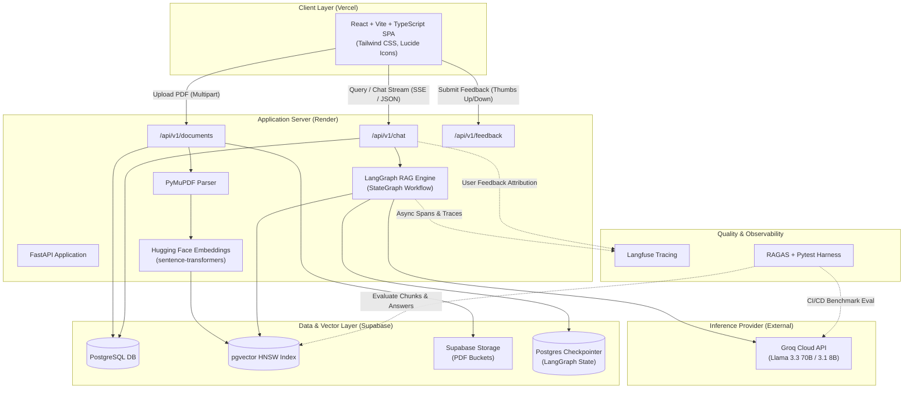
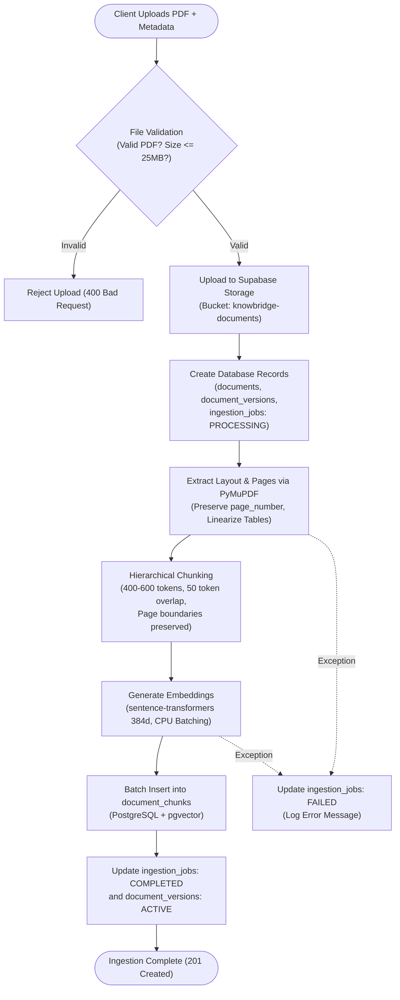
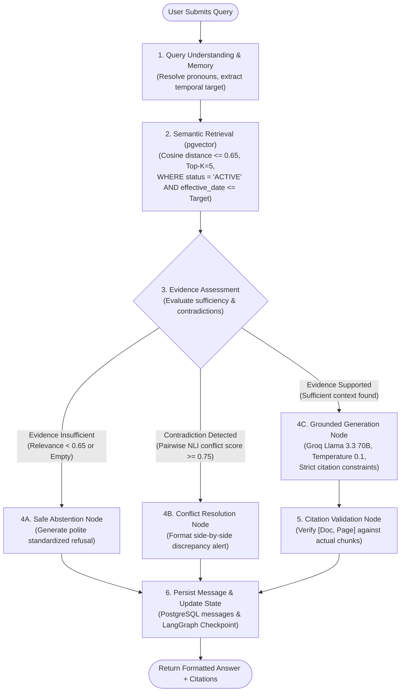
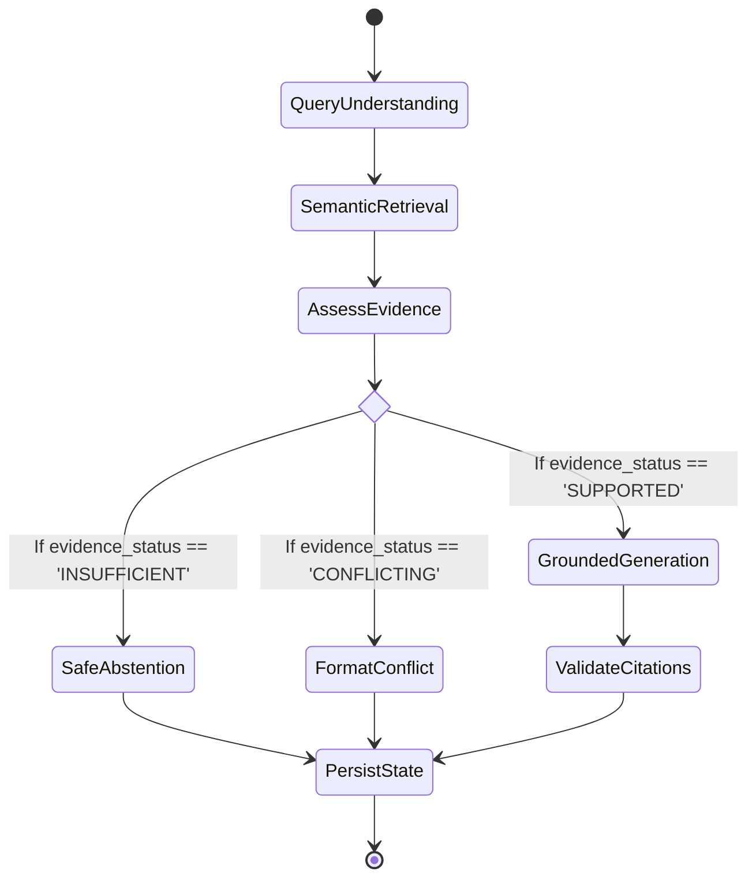
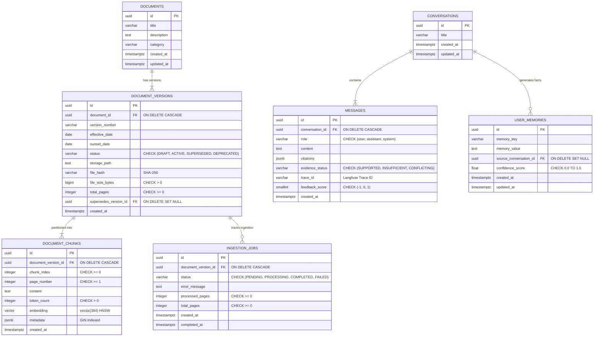
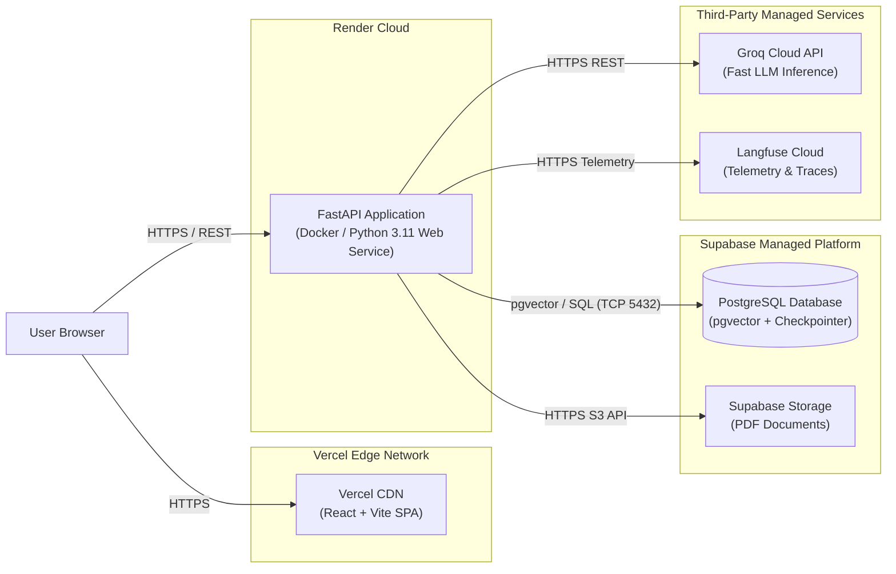

# KnowBridge AI — System Design Document

**Document Version:** 1.0.0  
**Status:** Under Review (Task 02 Specification)  
**Author:** Senior Software Architect & AI Engineer  
**Target Architecture:** Policy-Aware Enterprise Knowledge Intelligence Platform  

---

## 1. Product Overview

### 1.1 Problem Statement
Modern enterprise employees struggle to retrieve accurate, timely, and authoritative information from fragmented organizational repositories. Common failure modes include:
- Ingestion of unindexed, layout-complex PDF manuals and policy handbooks.
- Silent reliance on superseded or deprecated policy versions.
- Undetected contradictions between general organizational policies and departmental addenda.
- Generative LLM hallucinations lacking verifiable, page-level provenance.
- Inability of standard search engines to maintain conversational context and session memory.

### 1.2 Product Objectives
**KnowBridge AI** is an enterprise-grade Knowledge Intelligence platform built with Retrieval-Augmented Generation (RAG) and LangGraph. The platform achieves four core objectives:
1. **Mathematical Grounding:** Ensure every generated answer is strictly supported by retrieved evidence with verifiable page-level citations.
2. **Temporal & Version Awareness:** Guarantee that queries retrieve currently active policy versions by default, while supporting point-in-time auditing.
3. **Contradiction Transparency:** Detect and alert users to conflicting evidence across documents rather than synthesizing false consensus.
4. **Deterministic Safe Abstention:** Confidently refuse to answer when evidence is insufficient or absent.

### 1.3 Main Features
- **Enterprise Document Processing:** Native PDF parsing, table linearization, page-preserving chunking, and metadata extraction using PyMuPDF.
- **Hybrid Semantic Retrieval:** Dense vector retrieval using `sentence-transformers` embeddings stored in Supabase PostgreSQL with `pgvector` HNSW indexing, filtered by document version and effective date.
- **Stateful LangGraph Orchestration:** Multi-step graph-based workflow managing query reformulation, retrieval, evidence sufficiency scoring, conflict detection, grounded synthesis, and citation validation.
- **Dual Memory Layer:** LangGraph Postgres checkpointer for conversation session state combined with long-term memory tables in PostgreSQL.
- **Automated Quality & Observability:** Production tracing via Langfuse and quantitative evaluation via RAGAS and Pytest.

### 1.4 MVP Boundaries & Scope Restrictions
To ensure rapid delivery within a focused 10-hour implementation window:
- **Authentication & Authorization are strictly OUT OF SCOPE:** No login, registration, JWT handling, Supabase Row-Level Security (RLS), RBAC, or organization-level isolation. The MVP operates in a single-workspace development configuration.
- **No Heavy Distributed Infrastructure:** No Kafka, RabbitMQ, Redis, or dedicated graph databases (Neo4j). All state persistence, vector search, and checkpointing run natively in Supabase PostgreSQL.
- **Focused File Formats:** High-precision digital PDF documents processed via PyMuPDF. Scanned OCR and multi-modal image analysis are deferred to Phase 2.

---

## 2. High-Level Architecture

The KnowBridge AI system follows a clean modular client-server architecture designed for high maintainability, low operational complexity, and rapid deployment.



---

## 3. Low-Level Architecture & Component Responsibilities

```
┌───────────────────────────────────────────────────────────────────────────────────┐
│                           BACKEND MODULE DIRECTORY                                │
├───────────────────────────────┬───────────────────────────────────────────────────┤
│ Module Path                   │ Core Architectural Responsibility                 │
├───────────────────────────────┼───────────────────────────────────────────────────┤
│ app/api/v1/                   │ FastAPI route definitions and request/response validation│
│ app/core/config.py            │ Pydantic v2 application settings and env loading  │
│ app/services/ingestion.py     │ PyMuPDF text/table extraction, chunking, storage  │
│ app/services/embedding.py     │ Sentence-transformers embedding generation        │
│ app/services/vector_store.py  │ Supabase pgvector queries, similarity & metadata filter│
│ app/services/memory.py        │ Conversation history and long-term user memory    │
│ app/graph/                    │ LangGraph state, nodes, edges, and workflow graph │
│ app/graph/state.py            │ TypedDict schema for pipeline state               │
│ app/graph/nodes/              │ Discrete LangGraph execution nodes                │
│ app/eval/                     │ RAGAS metric runner and Pytest test suites        │
│ app/observability/            │ Langfuse tracer setup and telemetry utilities     │
└───────────────────────────────┴───────────────────────────────────────────────────┘
```

### 3.1 Document Ingestion & Parser Service (`app/services/ingestion.py`)
- **Responsibility:** Ingests raw PDF documents, stores originals in Supabase Storage, validates document integrity, extracts text, tables, and physical page numbers using PyMuPDF (`fitz`), and decomposes documents into semantically coherent chunks.
- **Inputs:** Binary PDF upload stream, document metadata (`title`, `version`, `effective_date`, `sunset_date`).
- **Outputs:** Stored file record in Supabase Storage, normalized document rows in `documents` and `document_versions`, and structured chunk objects containing `text`, `page_number`, and token counts.

### 3.2 Chunking & Embedding Service (`app/services/embedding.py`)
- **Responsibility:** Transforms text chunks into fixed-dimensional vector representations.
- **Model:** Hugging Face `sentence-transformers/all-MiniLM-L6-v2` (384 dimensions) or `BAAI/bge-small-en-v1.5`. Runs in-process on CPU with batching.
- **Inputs:** List of cleaned string chunks.
- **Outputs:** List of 384-dimensional float vectors ready for insertion into `document_chunks`.

### 3.3 Vector Store & Retrieval Service (`app/services/vector_store.py`)
- **Responsibility:** Executes vector similarity search with metadata pre-filtering against Supabase PostgreSQL using `pgvector`.
- **Search Logic:** Computes cosine distance (`<=>` operator) combined with SQL `WHERE` clauses enforcing active status (`status = 'ACTIVE'`) and effective-date validity.
- **Inputs:** Query vector (384d), target date, top-k limit (default: 5), similarity threshold.
- **Outputs:** List of candidate chunk records containing content, score, document title, version, and page number.

### 3.4 LangGraph Orchestrator (`app/graph/`)
- **Responsibility:** Encapsulates the entire RAG lifecycle as a directed, stateful execution graph. It handles query reformulation, conversational memory retrieval, pgvector semantic search, evidence sufficiency assessment, contradiction detection, grounded synthesis via Groq, and citation verification.
- **Inputs:** User message, `conversation_id`, temporal override (optional).
- **Outputs:** Formatted answer string, citation metadata array, conflict flags, and updated conversation state.

### 3.5 Evidence Assessment & Conflict Engine (`app/graph/nodes/assess_evidence.py`)
- **Responsibility:** Inspects retrieved chunks to determine whether the evidence is:
  1. **Sufficient:** Contains factual coverage to answer the query.
  2. **Insufficient:** Lacks relevant clauses, requiring safe abstention.
  3. **Conflicting:** Contains mutual contradictions across co-retrieved documents.
- **Mechanism:** Pairwise Natural Language Inference (NLI) prompting via Groq (`Llama 3.3 70B`).

### 3.6 Answer Synthesis & Citation Verifier (`app/graph/nodes/generate_answer.py`)
- **Responsibility:** Prompts Groq with strict provenance instructions, demanding inline `[Document Title, Page X]` anchors. Post-processing validates that cited page numbers actually exist in the retrieved context chunks.
- **Inputs:** Filtered evidence chunks, resolved user query.
- **Outputs:** Verified answer string and structured citation metadata list.

### 3.7 Observability & Evaluation (`app/observability/`, `app/eval/`)
- **Responsibility:** Instruments every LangGraph node execution as a child span within a Langfuse trace, logging model parameters, latency, token consumption, and cost. Provides automated offline and CI/CD quality gates using RAGAS and Pytest.

---

## 4. Document Ingestion Workflow

The ingestion pipeline transforms raw enterprise PDF documents into searchable, page-attributed vector chunks.



### Ingestion Step Details
1. **Validation:** Checks MIME type (`application/pdf`) and enforces a 25MB file size limit.
2. **Storage:** Uploads the binary stream to Supabase Storage under path `{doc_id}/{version_id}/{filename}`.
3. **Database Version Registration:** Creates an entry in `documents` and an associated `document_versions` row with `effective_date`, `version_number`, and `status = 'PROCESSING'`.
4. **PyMuPDF Extraction:** Iterates through each physical page, extracting clean text while preserving physical page indices (`page_number = page.number + 1`). Tables are extracted and linearized into clean Markdown tables.
5. **Page-Preserving Chunking:** Employs recursive token-aware chunking ($400 - 600$ tokens). Chunks inherit the exact page number of their origin. If a chunk spans a page boundary, both `page_start` and `page_end` are logged.
6. **In-Memory Embedding:** Chunks are embedded in batches using `sentence-transformers/all-MiniLM-L6-v2`.
7. **Database Persistence:** Inserts records into `document_chunks` using `execute_values` or SQLAlchemy bulk operations with `status = 'ACTIVE'`.

---

## 5. RAG Query Workflow

The query workflow handles user interaction through multi-step reasoning, temporal filtering, and conditional routing based on evidence assessment.



### Evidence Branching Logic
- **Branch A (Insufficient Evidence):** If no retrieved chunk exceeds a cosine similarity threshold of $0.65$ or the model determines the text does not address the query, execution routes immediately to `NodeAbstain`. The model explicitly refuses to guess and offers escalation guidance.
- **Branch B (Conflicting Evidence):** If the Cross-Evidence NLI engine identifies a pairwise contradiction between two active policy chunks (e.g., conflicting reimbursement caps), execution routes to `NodeConflict`. The system presents both conflicting clauses with their respective source titles and page numbers.
- **Branch C (Supported Evidence):** If consistent and sufficient evidence is available, execution routes to `NodeGenerate`. The model synthesizes the response with inline citations (`[Title, Page X]`). `NodeValidateCitations` verifies each citation against the retrieved chunks before delivering the final payload.

---

## 6. LangGraph State & Orchestration Architecture

The query pipeline is modeled as a compiled `StateGraph` in LangGraph.

### 6.1 Typed State Definition (`AgentState`)
```python
from typing import TypedDict, List, Dict, Any, Optional
from datetime import date

class Citation(TypedDict):
    citation_id: int
    document_id: str
    document_title: str
    page_number: int
    snippet: str

class PolicyConflict(TypedDict):
    claim_a: str
    source_a: str
    page_a: int
    claim_b: str
    source_b: str
    page_b: int
    contradiction_reason: str

class AgentState(TypedDict):
    # Session identifiers
    conversation_id: str
    user_id: Optional[str]
    
    # Input and Reformulation
    raw_query: str
    rephrased_query: str
    target_date: Optional[str]  # ISO format "YYYY-MM-DD"
    
    # Memory Context
    conversation_history: List[Dict[str, str]]
    user_facts: List[str]
    
    # Retrieval
    retrieved_chunks: List[Dict[str, Any]]
    
    # Decision flags
    evidence_status: str  # "SUPPORTED" | "INSUFFICIENT" | "CONFLICTING"
    conflicts: List[PolicyConflict]
    
    # Output synthesis
    raw_answer: str
    final_answer: str
    citations: List[Citation]
    validation_status: bool  # True if all citations are verified
    error_message: Optional[str]
```

### 6.2 Graph Topology & Edge Routing


---

## 7. Database Design & Entity Schemas

All data entities reside in Supabase PostgreSQL with the `vector` extension enabled (`CREATE EXTENSION IF NOT EXISTS vector;`). Primary keys use `UUID` generated via `gen_random_uuid()`.

### Table 1: `organizations` (Optional Future Extension)
> **Note on Scope:** This table is defined solely for future multi-tenancy compatibility. It is **NOT** used for authorization, authentication, or row filtering in the MVP.
- `id` (UUID, Primary Key, `DEFAULT gen_random_uuid()`)
- `name` (VARCHAR(255), NOT NULL)
- `slug` (VARCHAR(100), UNIQUE, NOT NULL)
- `created_at` (TIMESTAMPTZ, NOT NULL, `DEFAULT NOW()`)

### Table 2: `documents`
- `id` (UUID, Primary Key, `DEFAULT gen_random_uuid()`)
- `title` (VARCHAR(255), NOT NULL)
- `description` (TEXT, NULL)
- `category` (VARCHAR(100), NOT NULL, `DEFAULT 'general'`)
- `created_at` (TIMESTAMPTZ, NOT NULL, `DEFAULT NOW()`)
- `updated_at` (TIMESTAMPTZ, NOT NULL, `DEFAULT NOW()`)
- **Indexes:** `idx_documents_category` ON `documents(category)`.

### Table 3: `document_versions`
- `id` (UUID, Primary Key, `DEFAULT gen_random_uuid()`)
- `document_id` (UUID, NOT NULL, Foreign Key $\to$ `documents(id)` ON DELETE CASCADE)
- `version_number` (VARCHAR(50), NOT NULL)
- `effective_date` (DATE, NOT NULL)
- `sunset_date` (DATE, NULL)
- `status` (VARCHAR(50), NOT NULL, `DEFAULT 'ACTIVE'`) — Enum values: `DRAFT`, `ACTIVE`, `SUPERSEDED`, `DEPRECATED`
- `storage_path` (TEXT, NOT NULL)
- `file_hash` (VARCHAR(64), NOT NULL) — SHA-256 hash for deduplication
- `file_size_bytes` (BIGINT, NOT NULL)
- `total_pages` (INTEGER, NOT NULL)
- `supersedes_version_id` (UUID, NULL, Foreign Key $\to$ `document_versions(id)`)
- `created_at` (TIMESTAMPTZ, NOT NULL, `DEFAULT NOW()`)
- **Indexes:**
  - `idx_doc_versions_lookup` ON `document_versions(document_id, status)`
  - `idx_doc_versions_temporal` ON `document_versions(effective_date, sunset_date)`

### Table 4: `document_chunks`
- `id` (UUID, Primary Key, `DEFAULT gen_random_uuid()`)
- `document_version_id` (UUID, NOT NULL, Foreign Key $\to$ `document_versions(id)` ON DELETE CASCADE)
- `chunk_index` (INTEGER, NOT NULL)
- `page_number` (INTEGER, NOT NULL)
- `content` (TEXT, NOT NULL)
- `token_count` (INTEGER, NOT NULL)
- `embedding` (VECTOR(384), NOT NULL)
- `metadata` (JSONB, NOT NULL, `DEFAULT '{}'::jsonb`)
- `created_at` (TIMESTAMPTZ, NOT NULL, `DEFAULT NOW()`)
- **Indexes:**
  - `idx_chunks_vector_hnsw` ON `document_chunks USING hnsw (embedding vector_cosine_ops)` WITH `(m = 16, ef_construction = 64)`
  - `idx_chunks_page` ON `document_chunks(document_version_id, page_number)`

### Table 5: `conversations`
- `id` (UUID, Primary Key, `DEFAULT gen_random_uuid()`)
- `title` (VARCHAR(255), NOT NULL, `DEFAULT 'New Conversation'`)
- `created_at` (TIMESTAMPTZ, NOT NULL, `DEFAULT NOW()`)
- `updated_at` (TIMESTAMPTZ, NOT NULL, `DEFAULT NOW()`)

### Table 6: `messages`
- `id` (UUID, Primary Key, `DEFAULT gen_random_uuid()`)
- `conversation_id` (UUID, NOT NULL, Foreign Key $\to$ `conversations(id)` ON DELETE CASCADE)
- `role` (VARCHAR(20), NOT NULL) — Enum values: `user`, `assistant`, `system`
- `content` (TEXT, NOT NULL)
- `citations` (JSONB, NULL, `DEFAULT '[]'::jsonb`)
- `evidence_status` (VARCHAR(50), NULL)
- `trace_id` (VARCHAR(100), NULL) — Correlated Langfuse trace ID
- `feedback_score` (SMALLINT, NULL) — `1` (positive), `-1` (negative), `0` (neutral)
- `created_at` (TIMESTAMPTZ, NOT NULL, `DEFAULT NOW()`)
- **Indexes:** `idx_messages_conversation` ON `messages(conversation_id, created_at ASC)`.

### Table 7: `user_memories`
- `id` (UUID, Primary Key, `DEFAULT gen_random_uuid()`)
- `memory_key` (VARCHAR(100), NOT NULL) — e.g., `user_department`, `preferred_region`
- `memory_value` (TEXT, NOT NULL)
- `source_conversation_id` (UUID, NULL, Foreign Key $\to$ `conversations(id)` ON DELETE SET NULL)
- `confidence_score` (FLOAT, NOT NULL, `DEFAULT 1.0`)
- `created_at` (TIMESTAMPTZ, NOT NULL, `DEFAULT NOW()`)
- `updated_at` (TIMESTAMPTZ, NOT NULL, `DEFAULT NOW()`)

### Table 8: `ingestion_jobs`
- `id` (UUID, Primary Key, `DEFAULT gen_random_uuid()`)
- `document_version_id` (UUID, NOT NULL, Foreign Key $\to$ `document_versions(id)` ON DELETE CASCADE)
- `status` (VARCHAR(50), NOT NULL, `DEFAULT 'PENDING'`) — Enum values: `PENDING`, `PROCESSING`, `COMPLETED`, `FAILED`
- `error_message` (TEXT, NULL)
- `processed_pages` (INTEGER, NOT NULL, `DEFAULT 0`)
- `total_pages` (INTEGER, NOT NULL, `DEFAULT 0`)
- `created_at` (TIMESTAMPTZ, NOT NULL, `DEFAULT NOW()`)
- `completed_at` (TIMESTAMPTZ, NULL)

---

## 8. Entity Relationship (ER) Diagram (7 MVP Tables)



---

## 9. API Design & Endpoints

### 9.1 Documents & Ingestion API
- `POST /api/v1/documents/upload`
  - **Description:** Upload PDF, extract metadata, chunk, embed, and index.
  - **Content-Type:** `multipart/form-data`
  - **Form Fields:** `file` (Binary PDF), `title` (str), `version_number` (str), `effective_date` (YYYY-MM-DD), `category` (str, optional).
  - **Response (201 Created):**
    ```json
    {
      "job_id": "7f8b9a21-4f1b-489e-9d22-b52b2f0a1234",
      "document_id": "1a2b3c4d-...",
      "version_id": "9e8d7c6b-...",
      "status": "PROCESSING",
      "message": "Document uploaded successfully. Ingestion in progress."
    }
    ```
- `GET /api/v1/ingestion/{job_id}`
  - **Description:** Poll status of document processing.
  - **Response (200 OK):**
    ```json
    {
      "job_id": "7f8b9a21-...",
      "status": "COMPLETED",
      "processed_pages": 14,
      "total_pages": 14,
      "total_chunks": 42
    }
    ```
- `GET /api/v1/documents`
  - **Description:** List active enterprise documents with version metadata.
  - **Response (200 OK):** Array of document objects.

### 9.2 Conversational RAG & Chat API
- `POST /api/v1/chat`
  - **Description:** Execute RAG query with conversational memory and citation validation.
  - **Request Body (JSON):**
    ```json
    {
      "conversation_id": "a1b2c3d4-...",
      "message": "What is the daily meal allowance for business travel to London?",
      "temporal_target_date": "2024-11-21"
    }
    ```
  - **Response (200 OK):**
    ```json
    {
      "conversation_id": "a1b2c3d4-...",
      "message_id": "m1n2o3p4-...",
      "answer": "Under the 2024 Global Travel Policy, meals in London (Tier 1) are reimbursed up to £80 GBP per day [Global_Travel_Policy_2024.pdf, Page 14].",
      "evidence_status": "SUPPORTED",
      "citations": [
        {
          "citation_id": 1,
          "document_title": "Global_Travel_Policy_2024.pdf",
          "version": "v3.2",
          "page_number": 14,
          "snippet": "Tier 1 International Cities (London, Tokyo): Meals and incidentals cap is £80 per day."
        }
      ],
      "conflicts": [],
      "trace_id": "tr-langfuse-98124"
    }
    ```
- `GET /api/v1/conversations/{id}`
  - **Description:** Fetch conversation history and messages.

### 9.3 Feedback & Observability API
- `POST /api/v1/feedback`
  - **Description:** Attach user thumbs up/down feedback to a message and Langfuse trace.
  - **Request Body (JSON):**
    ```json
    {
      "message_id": "m1n2o3p4-...",
      "trace_id": "tr-langfuse-98124",
      "score": 1,
      "comment": "Accurate page reference."
    }
    ```

---

## 10. Memory Architecture

KnowBridge AI separates conversational memory into two distinct layers:

```
  ┌────────────────────────────────────────────────────────────────────────┐
  │                       MEMORY LAYER ARCHITECTURE                        │
  ├───────────────────────────────────┬────────────────────────────────────┤
  │ SHORT-TERM SESSION CHECKPOINT     │ LONG-TERM PERSISTENT MEMORY        │
  │ (LangGraph Postgres Checkpointer) │ (PostgreSQL user_memories Table)   │
  ├───────────────────────────────────┼────────────────────────────────────┤
  │ • Retains node execution state    │ • Persists extracted factual keys  │
  │ • Stores last 5 turns of dialogue │   (e.g., department, role, region) │
  │ • Scoped to `conversation_id`     │ • Survives conversation lifecycles │
  │ • Serialized state in Postgres    │ • Injected into query rewriting    │
  └───────────────────────────────────┴────────────────────────────────────┘
```

1. **Short-Term Conversational State (LangGraph Checkpointer):**
   - Utilizes LangGraph's PostgreSQL checkpointer (`PostgresSaver`).
   - Persists node-by-node execution state keyed by `thread_id = conversation_id`.
   - Enables seamless resumption and multi-turn query reformulation (e.g., resolving *"Does it cover orthodontics?"* to *"Does the Delta Dental Comprehensive plan cover orthodontics?"*).
2. **Long-Term Memory (`user_memories` table):**
   - As users interact, explicit background extraction identifies persistent parameters (e.g., *"I work in the UK engineering department"*).
   - Saved as key-value records (`memory_key: "department"`, `memory_value: "Engineering"`).
   - Injected into future query contexts to pre-filter departmental addenda.

---

## 11. Evaluation Architecture (RAGAS & Pytest)

Quality evaluation is structured as a dual-layer testing framework:

```
┌──────────────────────────────────────────────────────────────────────────────────┐
│                        DUAL-LAYER EVALUATION HARNESS                             │
├───────────────────────────────────┬──────────────────────────────────────────────┤
│ Layer 1: Deterministic Pytest     │ Layer 2: RAGAS Benchmark Suite               │
├───────────────────────────────────┼──────────────────────────────────────────────┤
│ • Validates citation format regex │ • Faithfulness (evaluates factual grounding) │
│ • Validates chunk page retention  │ • Answer Relevance (query semantic alignment)│
│ • Asserts safe abstention trigger │ • Context Precision (signal-to-noise ratio)  │
│ • Validates API payload schemas   │ • Context Recall (ground-truth capture)      │
│ • Runs in local unit test cycles  │ • Runs in CI/CD quality gates                │
└───────────────────────────────────┴──────────────────────────────────────────────┘
```

- **RAGAS Execution:** The test harness evaluates a golden dataset of enterprise Q&A pairs. Any regression below the configured thresholds (Faithfulness $< 0.95$, Answer Relevance $< 0.90$) fails the build.
- **Deterministic Assertions:**
  - Citation format validation: Checks that every citation matches `\[(.*?), Page (\d+)\]`.
  - Abstention verification: Feeds an unanswerable prompt (e.g., *"What is the CEO's personal phone number?"*) and asserts that `evidence_status == 'INSUFFICIENT'`.

---

## 12. Observability & Telemetry (Langfuse)

All LLM operations and retrieval spans are instrumented using Langfuse:

- **Root Trace:** Created per user query with attributes `conversation_id`, `user_query`, and `temporal_target`.
- **Child Spans:**
  - `span_query_rewrite`: Captures input history, rephrased query, and latency.
  - `span_pgvector_retrieval`: Captures top-k chunks, cosine similarity scores, and execution time.
  - `span_nli_assessment`: Captures pairwise contradiction evaluations and sufficiency scores.
  - `generation_groq_synthesis`: Records Groq model identifier (`llama-3.3-70b-versatile`), temperature ($0.1$), prompt tokens, completion tokens, calculated USD cost, and time to first token (TTFT).
- **User Feedback Loop:** Thumbs-up/down feedback submitted by the user is linked directly to the trace via `langfuse.score()`, providing visibility into retrieval degradation.

---

## 13. Deployment Architecture

The MVP deployment topology separates the frontend static SPA from the stateless backend container, with database and storage managed by Supabase.



---

## 14. Engineering Decisions, Trade-Offs & Roadmap

### 14.1 Key Decisions & Trade-Offs

| Decision | Selected Approach | Alternative Considered | Trade-Off & Justification |
|---|---|---|---|
| **Orchestration** | **LangGraph** | Naive LangChain / LlamaIndex | LangGraph allows cyclic graphs, conditional branching (abstention, conflict), and native Postgres state checkpointing needed for reliable RAG. |
| **Vector Storage** | **Supabase pgvector** | Pinecone / Weaviate / Qdrant | Keeps relational metadata, chunk embeddings, conversations, and checkpoints in a single database, eliminating cross-database synchronization complexity. |
| **Inference Engine** | **Groq API** | OpenAI / Anthropic APIs | Groq provides ultra-low latency inference ($>250\text{ tokens/s}$) on open-weights models (Llama 3.3 70B), keeping P95 latency under 3 seconds. |
| **Embeddings** | **Hugging Face sentence-transformers** | OpenAI `text-embedding-3-small` | Runs locally in-process on CPU with zero external API latency, zero API costs, and consistent 384d vectors. |
| **Document Parsing** | **PyMuPDF (`fitz`)** | Unstructured / LlamaParse / OCR | Extremely fast, reliable native PDF extraction preserving exact page boundaries and tables without external service dependencies. |
| **State Persistence** | **Postgres Checkpointer** | Redis | Redis was considered in high-level design, but using PostgreSQL for LangGraph checkpoints eliminates a secondary infrastructure component for the MVP. |

### 14.2 Known MVP Limitations & Future Roadmap
1. **Scanned PDF Support:** The MVP supports digital PDFs with text layers. Phase 2 will introduce Tesseract or cloud Vision OCR for scanned legacy documents.
2. **Access Control (RBAC):** Authentication and permissions are omitted for the MVP. Phase 2 will introduce Supabase RLS and JWT-based role enforcement.
3. **Automated Conflict Harmonization:** In MVP, conflicting policies trigger an alert banner. Phase 3 will introduce automated discrepancy resolution workflows with administrative approval.
